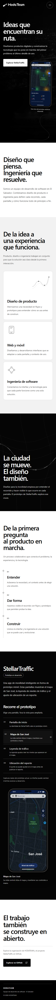
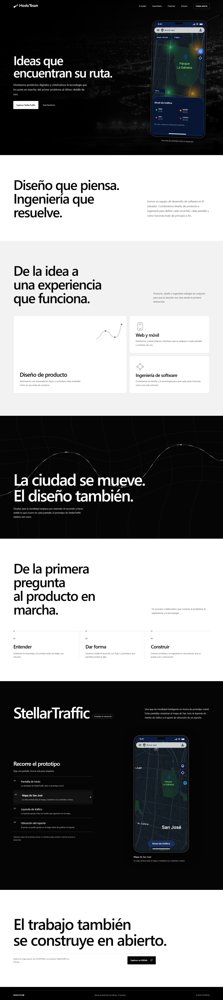

# Investigación, rediseño y validación de HODATEAM

**Fecha de revisión:** 15 de noviembre de 2026.  
**Proyecto:** landing existente en Angular 22, prerenderizada para servir archivos estáticos.  
**Objetivo:** dar a HODATEAM una identidad visual reconocible y explicar con precisión su trabajo y el estado de StellarTraffic, sin inventar capacidades del equipo ni del prototipo.

## 1. Dirección creativa en una frase

Una voz de estudio editorial y monocromática, construida alrededor de la idea de encontrar una ruta: negro, blanco y grises; tipografía sans uniforme; una fotografía urbana nocturna y la interfaz real de StellarTraffic como prueba de trabajo. El color se conserva dentro de las capturas originales del prototipo. El diseño toma principios de referentes, pero no reproduce su composición ni sus recursos de marca.

La llamada principal, **«Ideas que encuentran su ruta»**, enlaza con el caso de movilidad; el cierre deriva a la organización pública de GitHub. Las pantallas llevan la etiqueta “Proyecto en desarrollo” y una nota de que el prototipo puede cambiar. No se añadió formulario, descarga, página ni producto inexistente.

## 2. Investigación comparativa

Se revisaron doce páginas oficiales de producto, estudios y movilidad. Las observaciones describen recursos de jerarquía y comunicación; los sitios cambian con frecuencia y no son una plantilla para copiar.

| Referente | Dirección de arte, jerarquía y composición | Tipografía, color, imagen, motion y espacio | Navegación, CTA y decisión para HODATEAM |
|---|---|---|---|
| [Linear](https://linear.app/) | Navegación compacta, una promesa de producto directa y la interfaz como protagonista del hero; las secciones conectan capacidades con pantallas concretas. | Sans precisa, contraste oscuro y acentos controlados. La UI propia hace el trabajo visual; el movimiento es discreto y deja respirar la página. | La navegación orienta a producto, recursos y prueba. Adaptar la claridad y usar el prototipo real; no imitar su interfaz densa ni su paleta. |
| [Stripe](https://stripe.com/) | Encabezado directo, producto financiero explicado por capas y contenido que alterna promesa, demostración y evidencia. El hero equilibra frase y visual propio. | Tipografía de marca con escala amplia; recursos abstractos se apoyan en diagramas y elementos del producto. Espacio amplio y movimiento al servicio de explicar. | Ofrece caminos claros a producto, documentación y ventas. Adaptar una jerarquía por niveles y CTA distintos por intención; evitar la amplitud de claims B2B que no aplica al equipo. |
| [Vercel](https://vercel.com/) | Mensaje específico para desarrollo y despliegue, jerarquía muy marcada y demostraciones que se vinculan al uso técnico. | Lenguaje visual oscuro, tipografía sans limpia, código e interfaz como material principal. Los cambios de estado destacan el producto, no el scroll por sí mismo. | Distingue acceso al producto y contacto comercial. Adaptar la especificidad y una acción principal; no trasladar el monocromo o los efectos de infraestructura como decoración. |
| [Framer](https://www.framer.com/) | El lienzo editable comunica el producto desde el primer tramo; luego aparecen plantillas, casos de uso y ejemplos reales. | La tipografía es expresiva pero legible; interfaces y sitios publicados son la imagen central. El movimiento puede ser intenso porque demuestra una herramienta visual. | La prueba del producto y los ejemplos tienen salidas claras. Adaptar la demostración inmediata de una interfaz; evitar animación continua que aquí no añade comprensión. |
| [Notion](https://www.notion.com/) | Titular breve, producto reconocible y secuencia de funciones, casos y prueba. La estructura reduce una plataforma amplia a tareas concretas. | Sans contemporánea, tonos claros con acentos de marca y capturas con ilustraciones contenidas; bloques de contenido alternan con espacios abiertos. | Navegación por soluciones, recursos y acceso al producto. Adaptar la traducción de capacidades a beneficios comprensibles; no usar ilustraciones decorativas fuera de contexto. |
| [Apple](https://www.apple.com/) | Las páginas de producto dan prioridad a una imagen grande y un solo foco; texto breve y capítulos visuales sostienen la historia. | Tipografía de sistema muy escalada, fondos claros u oscuros según el producto, imagen de producto nítida y espacio negativo deliberado. El motion acompaña la presentación. | Acciones de compra o exploración están separadas. Adaptar foco, escala y espacio; no fingir que HODATEAM vende un dispositivo terminado. |
| [Samsung Galaxy S26](https://www.design.samsung.com/global/contents/view/galaxy-s26) | El relato conecta diseño industrial, software y situaciones de uso cotidianas; la presentación alterna forma, detalle y experiencia. | Acabados sobrios, tipografía legible y espacio para que los detalles del producto sean la prueba. | Adaptar la coherencia entre interfaz y uso; no simular acabados físicos ni funciones de un dispositivo. |
| [Webflow](https://webflow.com/) | Presenta el producto con demostraciones y organiza contenido por tareas y perfiles, con evidencia de clientes y casos. | Tipografía de producto, color de marca y capturas del editor; alterna demostración y contenido explicativo para mantener ritmo. | Acceso, aprendizaje y venta tienen rutas propias. Adaptar la progresión de “qué hace / cómo se usa / para quién”; evitar sobrecargar la landing de HODATEAM con segmentos hipotéticos. |
| [Locomotive](https://locomotive.ca/en/work) | El portafolio deja que los proyectos sean la navegación visual: imágenes grandes, nombres y relatos de caso con composiciones particulares. | Tipografía expresiva y layouts variables; motion y transiciones refuerzan la identidad de estudio. El espacio entre proyectos ayuda a ver cada caso como unidad. | Navegación sencilla entre trabajo y estudio. Adaptar ritmo editorial y proyecto real destacado; descartar scroll espectacular o transiciones costosas si distraen del prototipo. |
| [ustwo](https://ustwo.com/work/) | El estudio explica capacidades y las respalda con casos organizados por impacto y sector; el trabajo publicado sostiene la presentación. | Diseño humano y contemporáneo con imágenes de producto, personas y contexto, en vez de una sola metáfora visual repetida. | “Qué hacemos” conduce a pruebas en casos y experiencia. Adaptar la relación entre trabajo y proceso; no usar claims de impacto sin evidencia equivalente. |
| [Waze for Cities](https://www.waze.com/partners/wazeforcities) | Habla a autoridades y operadores: valor urbano, coordinación e incidentes en tiempo real antes de presentar herramientas y escenarios. | Mapas, señales e ilustraciones ligados a movilidad; color intenso y estados visuales permiten reconocer alertas. Bloques claros separan tareas. | CTA de participación y rutas de información para ciudades. Adaptar lenguaje concreto y visualización vinculada al mapa; no importar su marca, paleta ni la idea de datos en vivo a un prototipo. |
| [TomTom Route Monitoring](https://www.tomtom.com/products/route-monitoring/) | Explica seguimiento de rutas con tiempos, retrasos y segmentos; combina utilidad, demostración y escenarios para autoridades, eventos y emergencias. | Mapa, ruta y métricas son evidencia visual; interfaz y demo convierten el concepto en acción. La página separa portal listo para usar de acceso API. | Las salidas de prueba, portal, API y contacto son explícitas. Adaptar la conexión entre problema, herramienta y caso; no presentar funciones o datos de tráfico de StellarTraffic que aún no existan. |

### Patrones que sí aportan

- La gente entiende antes una interfaz real, un caso o un dato pertinente que una ilustración genérica.
- La promesa se vuelve creíble cuando se acompaña de una acción principal y evidencia concreta.
- El ritmo depende de alternar escalas, fondos y densidades; no de repetir la misma cuadrícula o tarjeta.
- Los movimientos más útiles revelan jerarquía o estado. Un efecto no gana valor solo por reaccionar al scroll.
- En movilidad, mapas y alertas son parte de la explicación del producto y requieren distinguir con claridad qué está disponible ahora.

**Dirección final:** una composición editorial en blanco, negro y gris que conecta equipo, capacidades y proceso con un caso real de movilidad. Se retiene la foto urbana licenciada, se usa la ruta como lenguaje gráfico y el color queda en las capturas auténticas de StellarTraffic. La selección aplica el foco y el espacio de Apple, la atención al uso cotidiano observada en Samsung y la explicación por tareas de Waze for Cities, sin copiar sus composiciones ni prometer tráfico en vivo.

Para movimiento se consultó la documentación de [GSAP ScrollTrigger](https://gsap.com/docs/v3/Plugins/ScrollTrigger/) y se prefirieron CSS e `IntersectionObserver`, suficientes para esta composición. Se respetó `prefers-reduced-motion` conforme al [comportamiento de medios de movimiento reducido](https://developer.mozilla.org/en-US/docs/Web/CSS/@media/prefers-reduced-motion).

## 3. Auditoría inicial

El sitio ya tenía información útil, capturas auténticas de StellarTraffic, navegación por anclas y una base Angular que podía conservarse. La evaluación de la landing original encontró:

- **El hero no diferenciaba bien al equipo del proyecto.** La foto nocturna genérica creaba ambiente, pero por sí sola no explicaba qué construye HODATEAM. Se integró con una pantalla real del prototipo y un titular que conecta diseño, tecnología y ruta.
- **La página repetía un tono oscuro y una aparición similar de elementos.** Esto aplanaba la lectura. La primera pasada alternó superficies claras y oscuras y abrió el ritmo con listas y capturas; la revisión actual lo simplifica a blanco y negro.
- **La navegación tenía CTA poco diferenciados.** Se consolidó el recorrido principal hacia `#proyectos`; el cierre queda para la organización de GitHub. No se inventó un canal de contacto.
- **El lenguaje de StellarTraffic necesitaba reflejar su estado.** Se concreta como prototipo móvil en desarrollo y se conservan las cuatro pantallas reales aportadas por el equipo.
- **Rendimiento inicial móvil:** 90 / 100 en rendimiento, accesibilidad, buenas prácticas y SEO. LCP 3,5 s, TBT 130 ms, CLS 0 y 470 KiB transferidos.

Las capturas y el informe inicial de Lighthouse se conservan en `artifacts/lighthouse/`.

## 4. Qué cambió

### Hero y composición

- Nuevo titular “Ideas que encuentran su ruta”, texto de posicionamiento, un CTA claro a StellarTraffic y un enlace secundario a capacidades en escritorio.
- El hero combina foto urbana monocromática con la pantalla real del mapa, enmarcada como teléfono; superpone una ruta vectorial tenue y mantiene texto legible mediante un velo oscuro. En escritorio el titular se resuelve en dos líneas; en móvil el teléfono baja de escala y acompaña el CTA sin taparlo.
- En móvil usa un recorte vertical de la misma foto, y el teléfono se ubica debajo del bloque de texto para evitar la antigua colisión con el botón.
- Las capturas de StellarTraffic se presentan con estado de desarrollo, explicación y un visor nativo `<dialog>` con cierre por teclado/Escape.

### Tipo, color y narrativa

- Sans uniforme para lectura, navegación y titulares. No se descarga ninguna fuente en tiempo de ejecución.
- Negro, blanco y grises reemplazan la paleta petróleo, papel y lima de la primera pasada. La fotografía y la línea de ruta son monocromáticas; el color del producto queda intacto dentro de las capturas reales.
- Se retiraron etiquetas repetidas, firma duplicada y adornos para despejar la jerarquía. Las capacidades usan una composición asimétrica con una tarjeta protagonista y dos de apoyo; aparecen con un desfase breve al entrar en pantalla.
- Se reescribieron equipo, capacidades, proceso y proyecto en torno a lo que el equipo afirma que hace. Se redujeron etiquetas de relleno y se conservaron secciones útiles.
- StellarTraffic presenta cuatro estados reales del prototipo, cada uno con una explicación concreta. La selección cambia la pantalla enmarcada, actualiza el texto y señala el estado activo; al tocarla se abre una ampliación que también funciona con teclado.

### Motion e interacción

1. El hero coordina la entrada del texto, la foto y el teléfono en menos de un segundo.
2. La sección de ciudad traza la ruta y mueve puntos sobre un mapa vectorial abstracto. La animación se activa al entrar en pantalla y se detiene al salir.
3. Las capacidades y etapas del proceso se revelan con una entrada escalonada breve; el cambio de pantalla del prototipo y el diálogo tienen transiciones contenidas.

Los estados de foco y hover son visibles, el menú móvil se cierra con Escape y la galería se puede abrir y cerrar con teclado. Con movimiento reducido se desactivan las animaciones y no se oculta contenido.

### Imágenes y licencia

- Se mantuvo la foto urbana de Raúl Escobar alojada localmente y ya acreditada en el README. Se distribuye bajo la [licencia de Unsplash](https://unsplash.com/license); se añadieron derivados WebP para móvil y el logo del encabezado. La tarjeta social existente se pasó a escala de grises.
- El logo visible pasó de PNG de 27 KB a WebP de 5,45 KB; el recorte vertical móvil pesa unos 55 KB. Las cuatro capturas del prototipo siguen optimizadas en WebP y se cargan de forma diferida.
- La fotografía de fondo es de Santiago de Chile, mientras el prototipo muestra San José y el equipo se identifica con El Salvador. Sirve como contexto urbano, pero una foto propia o de la ciudad que el equipo quiera representar sería una mejora de identidad cuando esté disponible y licenciada.

## 5. Resultado visual

Se capturó e inspeccionó la página completa a siete anchuras. Se revisaron especialmente 320, 375, 768 y 1440 px después de implementar; se ajustó la escala del titular y la composición móvil para que el CTA y el teléfono no se superpusieran.

Las otras capturas están en `artifacts/redesign/responsive-{320,430,768,1024,1920}.png`.

**Revisión estética final:** blanco, negro y superficies grises ordenan los tramos de lectura; el hero muestra el caso real con un titular de dos líneas en escritorio; el mapa animado crea el cambio de ritmo y el prototipo conserva sus colores auténticos. La foto de stock sigue siendo el recurso menos propio, y queda documentada arriba.

## 6. Lighthouse antes y después

Lighthouse 13.6.0, compilación de producción servida desde `http://127.0.0.1:4200/`; tres navegaciones por perfil, comparadas por mediana y rango. Lighthouse aplicó emulación móvil y preset de escritorio. Son mediciones sintéticas locales, no datos de usuarios ni de producción.

| Perfil / métrica | Inicial | Rediseño | Cambio |
|---|---:|---:|---:|
| Perfil / métrica | Inicial | Versión actual | Cambio |
|---|---:|---:|---:|
| Móvil — rendimiento (mediana; rango de 3) | 90 | 92 (87–93) | +2 |
| Móvil — accesibilidad / buenas prácticas / SEO | 100 / 100 / 100 | 100 / 100 / 100 | se mantienen |
| Móvil — FCP / LCP (mediana) | 1,31 s / 3,50 s | 1,22 s / 3,10 s | −0,09 s / −0,40 s |
| Móvil — TBT / CLS / Speed Index (mediana) | 127 ms / 0 / 1,68 s | 140 ms / 0 / 1,62 s | TBT varía; SI mejora |
| Móvil — transferencia total | 470 KiB | 361 KiB | −109 KiB (≈23 %) |
| Escritorio — rendimiento (mediana; rango de 3) | 100 | 100 (99–100) | se mantiene |
| Escritorio — accesibilidad / buenas prácticas / SEO | 100 / 100 / 100 | 100 / 100 / 100 | se mantienen |
| Escritorio — FCP / LCP (mediana) | 0,31 s / 0,70 s | 0,34 s / 0,75 s | +0,03 s / +0,05 s |
| Escritorio — TBT / CLS / Speed Index (mediana) | 0 ms / 0 / 0,47 s | 3 ms / 0 / 0,66 s | cambios pequeños de laboratorio |
| Escritorio — transferencia total | 470 KiB | 464 KiB | −6 KiB |
| Agentic Browsing — móvil / escritorio | — | 100 / 100 | añadido en Lighthouse 13 |

El LCP móvil de 3,10 s todavía supera el objetivo de 2,5 s. Lighthouse identificó el logo del encabezado como el elemento LCP; ya es descubrible en el HTML y lleva prioridad alta. El informe local también marca falta de compresión HTTP en el servidor de prueba (ahorro estimado de 38 KiB) y recomienda reducir imágenes adaptándolas al tamaño mostrado. El origen de prueba no reproduce Brotli/gzip, caché ni red de Cloudflare Pages; conviene volver a medir al definir el dominio. El JavaScript sin compresión también domina el recurso transferido en este entorno.

TBT es una señal de laboratorio, no INP. No hay datos CrUX ni INP de usuarios reales disponibles, y Lighthouse local no permite inferir resultados de campo. Los seis informes individuales y sus metadatos de ejecución están en `lighthouse-final-{mobile,desktop}-{1,2,3}.json`.

## 7. QA funcional y responsive

| Anchura | Resultado |
|---:|---|
| 320, 375, 430 px | Sin overflow horizontal; hero y capturas enmarcadas caben y mantienen sus etiquetas. |
| 768, 1024 px | El layout transiciona entre menú y bloques de escritorio sin anchors rotos. |
| 1440, 1920 px | La escala tipográfica, proyecto y cierre permanecen dentro del ancho de contenido. |

La verificación con Chrome comprobó siete anchos, 7 secciones y 5 enlaces de navegación: ninguna imagen rota o pendiente, ninguna ancla faltante y cero errores de consola. Las 11 revelaciones aparecen al recorrer la página. El selector actualiza la captura y su descripción, el fondo animado se pausa al salir del viewport, el menú abre y cierra con Escape, y el diálogo se abre con Enter, recibe el foco y lo devuelve al cerrarse. Con movimiento reducido no se oculta contenido y `scroll-behavior` pasa a `auto`.

**Compilación y validación:** `npm run build` completó el prerender de la landing. Lighthouse puntuó accesibilidad en 100 en ambos perfiles; además, la verificación de teclado cubrió foco inicial, navegación hasta el prototipo, apertura y cierre del diálogo. La compilación conserva dos avisos de presupuesto de estilos de Angular: `site-sections.component.scss` (6,84 KB frente a 6 KB) y `project-showcase.component.scss` (6,57 KB frente a 6 KB).

## 8. Límites y siguientes pasos

- LCP móvil: 3,10 s en servidor local; es la métrica de laboratorio que todavía no alcanza la meta indicada. Revisar de nuevo con el dominio y CDN desplegados.
- Quedan avisos de presupuesto de CSS en dos componentes; la build funciona, pero se pueden reducir reglas o revisar el presupuesto del proyecto en una pasada posterior.
- INP de usuarios, WebPageTest, PageSpeed Insights de un dominio público y navegación con lector de pantalla no se comprobaron: no había despliegue público configurado para este encargo. Lighthouse y pruebas de teclado no sustituyen esa validación.
- Una foto propia de San Salvador, San José o el lugar que HODATEAM quiera representar daría más singularidad y coherencia que la imagen de stock conservada.
- El dominio de producción sigue sin definirse en la configuración. Cloudflare Pages debe probarse cuando se confirme el dominio, en especial canonical, caché y LCP real.

## 9. Índice de artefactos

- Capturas responsive: `responsive-320.png`, `responsive-375.png`, `responsive-430.png`, `responsive-768.png`, `responsive-1024.png`, `responsive-1440.png`, `responsive-1920.png`.
- Lighthouse final (3 ejecuciones por perfil): `lighthouse-final-mobile-{1,2,3}.json` y `lighthouse-final-desktop-{1,2,3}.json`.
- Resultados de interacción y tamaños: `layout-validation.json`.
- Verificador local reproducible: `verify-layout.mjs`.
- Servidor estático para servir la compilación local: `serve-production.mjs`.
- Informes Lighthouse iniciales y capturas base: `../lighthouse/`.
